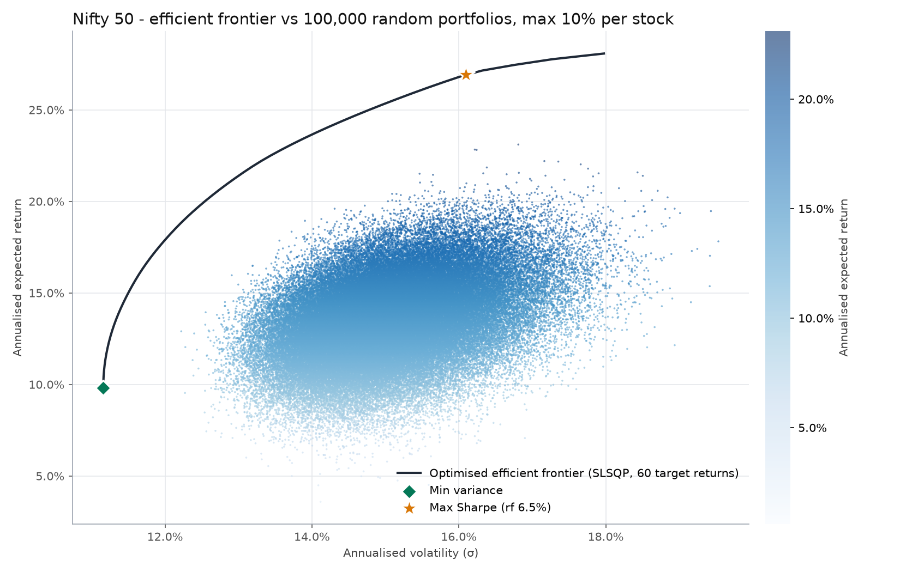
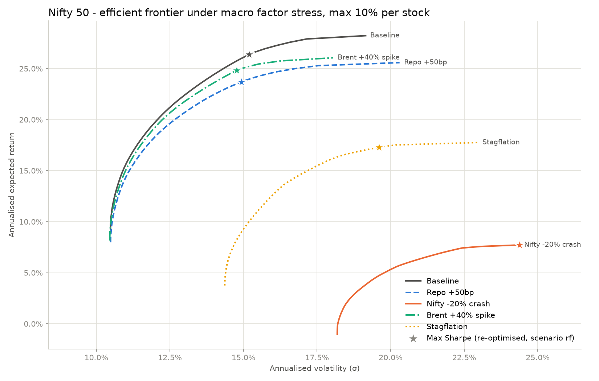
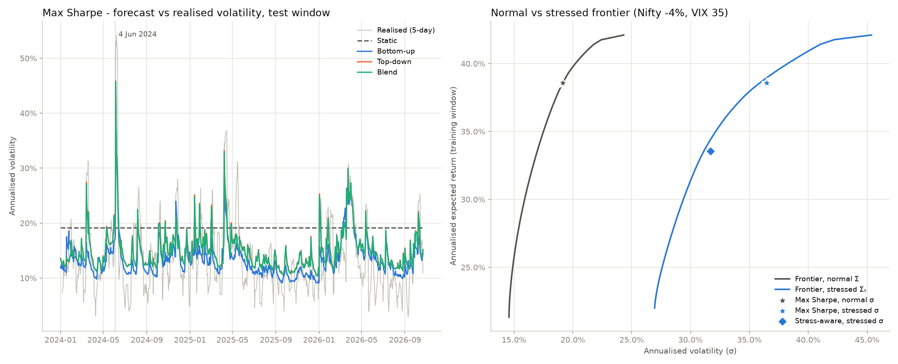
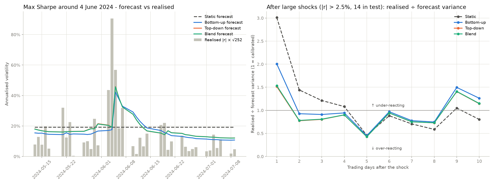
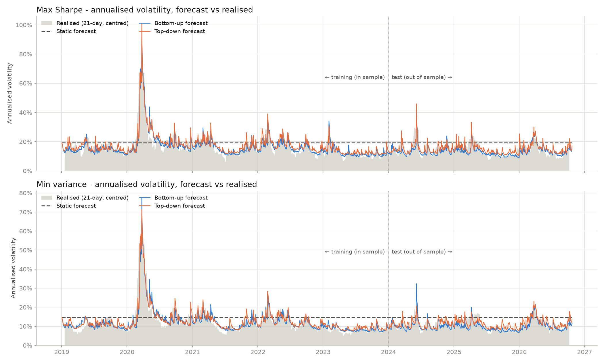
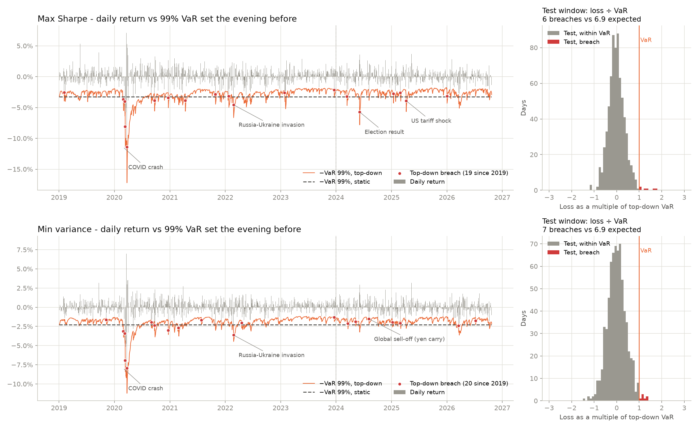
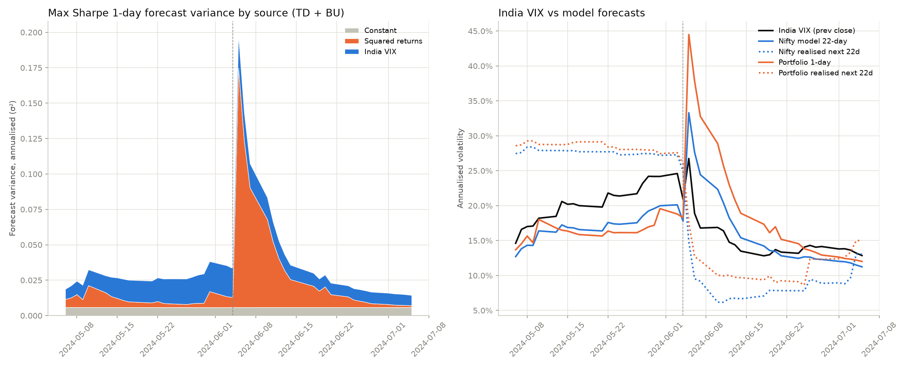

# Nifty 50 Portfolio Risk Models

How risky are optimised Nifty 50 portfolios, and how well do different risk models forecast that risk out of sample?

The project builds a capped long-only efficient frontier and stress-tests it against macro factors. It then compares six volatility models (static, bottom-up, top-down and three blends) on 2024–2026 data the models never saw, including the 4 June 2024 election-result shock.

All data comes from Yahoo Finance via `yfinance`. No API key is needed.

## Scripts

Run them in this order from the repository root. Later scripts import functions and parameters from earlier ones by file name, so keep all five in the same folder.

| # | Script | What it does | Runtime |
|---|--------|--------------|---------|
| 1 | `nifty50_efficient_frontier.py` | Simulates 100,000 random portfolios, plots the correlation matrix, and builds the efficient frontier with SLSQP, plus the exact min-variance and max-Sharpe portfolios | < 1 min |
| 2 | `nifty50_factor_stress.py` | Multi-factor macro stress test of those two portfolios, with a stressed frontier for each scenario | < 1 min |
| 3 | `nifty50_risk_layers.py` | Fits and scores static, bottom-up, top-down and blended risk models out of sample, and builds a stress-aware portfolio | several min |
| 4 | `nifty50_portfolio_var.py` | Daily volatility and 99% VaR of both portfolios from 2019 to today, with a backtest of breaches | several min |
| 5 | `nifty50_vol_attribution.py` | Case study of May–July 2024: an exact split of forecast variance by source, compared with India VIX | several min |

Scripts 3–5 each refit every GJR-GARCH model from scratch (one per stock, plus the market and each portfolio), so each takes a few minutes. Scripts 2–5 only import from 1 and 3, so you can run them on their own without running the earlier scripts first.

```bash
pip install -r requirements.txt
python nifty50_efficient_frontier.py
python nifty50_factor_stress.py
python nifty50_risk_layers.py
python nifty50_portfolio_var.py
python nifty50_vol_attribution.py
```

Each script prints its tables to the console and writes its PNGs and CSVs to the working directory. Copies from the last run are in [`figures/`](figures) and [`results/`](results).

## Method

Common settings for all scripts: long-only, at most 10% in any one stock, a 6.5% risk-free rate (about the Indian 10-year G-Sec yield), and 252 trading days a year.

### 1. Efficient frontier

- Random portfolios are drawn from a Dirichlet distribution with α = 0.3. Values below 1 concentrate weight in a few stocks, which spreads the cloud of portfolios further across the risk–return plane. Any weight above the 10% cap is clipped and the excess handed to the uncapped stocks in proportion to their weights.
- The frontier is the minimum variance portfolio at each of 60 target returns, solved with SLSQP. Each solve starts from the previous target's weights, which cuts the number of solver steps.
- Max Sharpe is solved directly, starting from the best frontier point.



### 2. Macro factor stress test

Weekly returns of each stock are regressed on five factors: Nifty 50, a 10-year G-Sec ETF (bond prices), and Brent, gold and copper converted to rupees. Weekly data avoids the timing mismatch between the NSE close and the US commodity futures settlement.

Σ = B Σ_f B′ + Σ_e, where Σ_e is the full residual covariance (not just its diagonal).

A scenario shocks some factors. Every other factor moves by its expected value given those shocks, E[f_u | f_s] = Σ_us Σ_ss⁻¹ Δf_s, so a Nifty crash also pulls copper down. Factor volatilities can be scaled too. A repo rate change becomes a bond move through an assumed 0.6 pass-through to the 10-year yield and a duration of 7, and the risk-free rate rises by the same yield change.

| Scenario | Max Sharpe shock P&L | Max Sharpe Sharpe | Avg weighted correlation |
|---|---|---|---|
| Baseline | 0.0% | 1.31 | 0.23 |
| Repo +50bp | −2.3% | 1.12 | 0.24 |
| Nifty −20% crash | −19.1% | 0.02 | 0.51 |
| Brent +40% spike | −1.8% | 1.19 | 0.23 |
| Stagflation | −11.9% | 0.32 | 0.38 |



### 3. Risk models compared out of sample

Models are fitted on 2019–2023, which includes the COVID crash, and scored on 2024 to today. The portfolios are re-optimised on the same training window, so they differ from those in script 1.

| Model | Variance forecast |
|---|---|
| Static | Sample covariance of the training window (the input to the SLSQP optimiser) |
| Bottom-up | One-factor model Σₜ = σ²ₘ,ₜ βₜβₜ′ + diag(hₜ). Market variance σ²ₘ,ₜ and each stock's residual variance hₜ follow a GJR-GARCH-X with lagged India VIX in the variance equation. The betas switch between a calm and a high-VIX set, depending on whether yesterday's VIX was above its 80th training percentile |
| Top-down | GJR-GARCH-X fitted directly to each portfolio's return series |
| TD + BU input (blend 1) | Top-down with the bottom-up forecast as an extra variance term, coefficient φ ≥ 0, tested with a likelihood ratio test |
| Blend (blend 3) | λ·h_TD + (1−λ)·h_BU, with λ chosen on 2023 using models fitted to 2019–2022. The test window is never used |
| Blend (state) | Blend 3 with separate λ for calm and high-VIX days |

Blend 2 (top-down sets the level, bottom-up the structure) is not scored as a forecast, since by construction it gives the same portfolio variance as top-down. It is used instead to back out the average correlation implied by the top-down level: ρ̄_cal = (h_TD − A)/(B − A), with A = Σwᵢ²σᵢ² and B = (Σwᵢσᵢ)².

**Scoring:** QLIKE, bias (realised ÷ forecast variance), 99% VaR breaches with the Kupiec test, the z-score on 4 June 2024, Mincer–Zarnowitz calibration, and an encompassing regression with Newey–West errors to check whether bottom-up adds information that top-down lacks.

**VaR** is filtered historical simulation: the 1% quantile of a model's standardised training returns times that day's forecast σ.

**Stress scenario:** Nifty −4% in a day with India VIX at 35. The rise in portfolio variance from calm to stressed is split into a volatility effect and a correlation effect using Shapley values, which average both orderings so the two parts add up exactly. A **stress-aware portfolio** maximises Sharpe subject to its volatility under the bottom-up stressed covariance staying below a limit.

Test-window results for the max-Sharpe portfolio (692 trading days, 6.9 VaR breaches expected):

| Model | QLIKE | Bias | VaR breaches | Kupiec p | 4 Jun 2024 z |
|---|---|---|---|---|---|
| Static | 1.004 | 0.63 | 2 | 0.03 | −4.7 |
| Bottom-up | 0.823 | 1.20 | 7 | 0.98 | −5.2 |
| Top-down | 0.806 | 0.99 | 6 | 0.72 | −4.7 |
| TD + BU input | 0.803 | 1.03 | 6 | 0.72 | −5.0 |
| Blend | 0.805 | 0.99 | 6 | 0.72 | −4.7 |

The static model overstates risk in the test window, as shown by its 0.63 bias and too few breaches. The bottom-up model understates it. The dynamic top-down models are close to calibrated, but every model treated the election-day loss as roughly a 5σ event. Full results for all three portfolios are in [`results/nifty50_risk_layers.csv`](results/nifty50_risk_layers.csv).




### 4. Volatility and VaR, 2019 to today

Static, bottom-up and top-down volatility forecasts against 21-day realised volatility, and a daily 99% VaR backtest. Breaches less than 10 trading days apart are grouped into episodes, and episodes near known shocks are labelled (COVID, the Russia–Ukraine invasion, the 2024 election, the August 2024 yen-carry sell-off, the April 2025 US tariffs).




### 5. June 2024 election: where the forecast variance came from

Every GJR-GARCH-X variance is the sum of today's inputs plus β times yesterday's variance. Unrolling that recursion assigns all of σ²ₜ to the input that created it, so the split is exact and additive. The script checks that the parts sum to the forecast to 1e-8. For blend 1, the bottom-up input is unrolled the same way into its Nifty and stock-level parts. This shows how much India VIX and squared returns contribute through each channel, which is where any double counting would show up.

The forecasts are also compared with India VIX on a like-for-like basis. VIX is the Nifty's expected volatility over the next 30 calendar days, so it is set against the Nifty model's average forecast over 22 trading days, not a 1-day forecast.



## Daily tracker

`tracker.py` follows the min-variance and max-Sharpe portfolios from `results/nifty50_optimal_portfolios.csv` forward in time, one trading day at a time, against a benchmark. The target weights are frozen at inception and the portfolios are never re-optimised.

```bash
python tracker.py init      # once: freeze targets, fit the VaR models
python tracker.py update    # each evening after the NSE close (GitHub Actions does this)
python tracker.py dashboard # build the dashboard page into site/
pytest                      # tests, no network needed
```

**Live dashboard:** https://khatuaryan10-ops.github.io/nifty50-portfolio-risk-models/. It is rebuilt after every evening run and shows value against the benchmark, drawdowns, daily return against VaR with breaches, current against target weights, rebalances, and the run log.

### What is tracked

One row per portfolio per trading day in `data/tracker.csv`:

| Column | Meaning |
|---|---|
| `value`, `daily_return`, `cumulative_return` | Value starts at 100 on the inception date |
| `vol_60d` | Annualised volatility of the last 60 daily returns (blank until 60 exist) |
| `drawdown`, `max_drawdown` | Current and worst fall from the running peak |
| `var_99_next` | 99% VaR for the next trading day, as a positive loss |
| `breach` | 1 if today's loss exceeded the VaR set the previous evening |
| `max_weight_drift` | Largest gap between a drifted weight and its target |
| `sigma2_next`, `flags` | Model variance state (%²), and notes such as missing prices or a rebalance |

**VaR** uses the top-down GJR-GARCH-X from script 3 (`gjr_fit`), fitted once at init on each portfolio's target-weight return series and never refitted. The fit starts on the first day all held stocks trade (late July 2021, when ETERNAL listed), so unlike script 3 it does not include COVID. Each evening, today's portfolio return and today's India VIX update the variance with one step of the same recursion. VaR is filtered historical simulation, as in script 3: the 1% quantile of the standardised training returns times tomorrow's σ.

### How returns are computed, and why

Every evening the tracker downloads the last ~10 trading days with `auto_adjust=False, actions=True`. From that single download it computes each stock's total return:

  rₜ = (Closeₜ + Dividendₜ) / Closeₜ₋₁ − 1

- **Total return, not price return.** Yahoo's `Close` excludes dividends, so the dividend is added back on its ex-date.
- **One fresh download.** Yahoo adjusts `Close` for splits across the whole history it returns, so prices within one download are always on the same basis and a split inside the window causes no jump. Prices stored from an earlier download may be on a different basis, so returns are **never** computed from stored prices, and adjusted closes are never used. `data/prices_raw.csv` keeps the raw `Close`, `Dividends` and `Stock Splits` for audit only.
- **Returns are the record.** Daily returns go to `data/returns.csv`. Values, drift and VaR are all built from them. History is only rewritten by the revision check below.

**Portfolio accounting.** r_p,t = Σ wᵢ,ₜ₋₁ rᵢ,ₜ, using yesterday's drifted weights. Then Valueₜ = Valueₜ₋₁ (1 + r_p,t), and the weights drift: wᵢ,ₜ = wᵢ,ₜ₋₁ (1 + rᵢ,ₜ) / (1 + r_p,t). A stock with no price that day keeps its weight at 0% and is flagged. When its price returns, its return is measured from its last close, so the missed move is not lost.

### Rebalance rule

On the first trading day of each quarter, after that day's return is applied, the weights reset to target. Each rebalance is logged in `data/rebalances.csv` with weights before and after, and turnover = ½ Σ |w_after − w_before|.

### Benchmark

The default is **^NSEI, the Nifty 50 price index, which excludes dividends**. Every output labels it that way, and it understates the index's total return by roughly the dividend yield (about 1–1.5% a year). The Nifty 50 TRI is published by niftyindices.com, which has no public API and blocks automated requests, so the tracker does not scrape it. To use the TRI instead, download its history from niftyindices.com (Reports → Historical data → Total Return Index). Save it as `data/nifty50_tri.csv` with columns `Date, TRI`, run `python tracker.py init --benchmark tri`, and append each day's level before the evening run. The source is fixed at init, so the series is never a splice of two sources.

### Data checks

- **Incremental and idempotent.** Only dates after the last stored date are added. Rows are keyed on date and portfolio, so running `update` twice on the same day changes nothing.
- **Gaps.** If runs were missed, the download window widens to reach back to the last stored date, and the job log says so.
- **Revisions.** Each run recomputes the returns of the last 5 stored dates from the fresh download. If any stock or benchmark return differs by more than 0.05%, those rows are overwritten, everything after them is recomputed, and the change is logged.
- **Holidays and incomplete days.** A day counts only if ^NSEI has a close, at least 90% of held stocks have one, and prices moved, so no zero-return holiday rows appear. A day missing too many stock prices waits for later runs. After 2 more sessions it goes in with 0% for the missing stocks.
- **Flags.** Any stock move above 20%, and any close unchanged for 3+ trading days, is flagged.
- **Job log.** `data/job_log.csv` gets one row per run: run time, status, dates added, revisions, warnings and errors.

### Weekly stability record

On Friday runs, `max_sharpe` and `min_variance_for_target` are re-solved on the trailing 5 years. The would-be weights and their turnover against the frozen targets go to `data/reoptimised_weights.csv`. This only measures how unstable the optimiser is. Nothing is traded on it.

### Files and scheduling

| File | Contents |
|---|---|
| `config/portfolios.yaml` | Frozen target weights, inception date, start value, benchmark |
| `state/models.json` | GARCH parameters, FHS quantile, inception and latest variance state |
| `data/tracker.csv`, `returns.csv`, `weights.csv` | Daily metrics, returns (plus India VIX) and drifted weights |
| `data/rebalances.csv`, `reoptimised_weights.csv`, `job_log.csv`, `prices_raw.csv` | Logs and audit data |

`.github/workflows/daily_tracker.yml` runs `update` Monday to Friday at 18:00 UTC (23:30 IST), commits `data/` and `state/`, then rebuilds the dashboard and deploys it to GitHub Pages. It can also be started by hand from the Actions tab. GitHub may start scheduled runs late, and it disables schedules in public repositories after 60 days without activity.

### Tracker limitations

- **Yahoo corporate actions.** NSE dividends are sometimes missing, and split adjustments sometimes arrive a day late. A late split shows up as a flagged move above 20%, which the revision check corrects if Yahoo fixes it within 5 days. Demergers are not adjusted at all.
- **Frozen universe.** Index changes do not affect the portfolios. A held stock that is delisted or renamed keeps its weight at 0% and is flagged every day until handled by hand.
- **Weights.** Weights below 1e-6 in the optimiser output are set to zero, and the rest renormalised, at init.

## Outputs

| File | From | Contents |
|---|---|---|
| `nifty50_optimal_portfolios.csv` | 1 | Min-variance and max-Sharpe weights and statistics |
| `nifty50_frontier.csv` | 1 | Every frontier point with its weights |
| `nifty50_factor_stress.csv` | 2 | Scenario results by portfolio |
| `nifty50_risk_layers.csv` | 3 | Out-of-sample scores, all models and portfolios |
| `nifty50_risk_layers_realised.csv` | 3 | Realised test-window return, volatility, drawdown |
| `nifty50_var_breaches.csv` | 4 | VaR breach episodes |

Script 1 also writes `nifty50_portfolios.csv` (statistics for all 100,000 random portfolios, about 9 MB) and `nifty50_portfolio_weights.npz` (their weights, about 35 MB). Both are excluded from the repository by `.gitignore`.

## Limitations

- **Two data windows.** Scripts 1 and 2 use a rolling 5-year window (`PERIOD = "5y"`), so their results change depending on the run date. Scripts 3–5 use a fixed start of 1 January 2019, with training ending 31 December 2023. The figures and CSVs here are from runs in October 2026.
- **Survivorship bias.** The stock list is today's Nifty 50, applied to the past. Stocks that left the index in the meantime are not included.
- **Dropped stocks.** Scripts 3–5 keep only stocks with prices from the start of 2019, so recent listings and demergers such as JIOFIN, ETERNAL (Zomato) and MAXHEALTH are excluded. Script 3 prints the exact list. Scripts 1 and 2 drop stocks with less than 80% of the 5-year history (JIOFIN in the last run).
- **Expected returns** are historical means, which are noisy, and the max-Sharpe portfolio is sensitive to them.
- **Stress assumptions.** The repo pass-through (0.6), bond duration (7) and the −4% / VIX 35 scenario are assumptions, not estimates.
- **Yahoo Finance data** is unofficial and occasionally has gaps or symbol changes. Edit `NIFTY50` in script 1 when the index composition changes.
